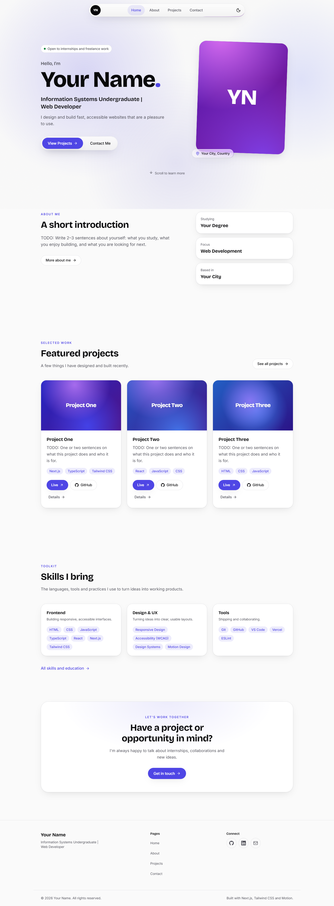
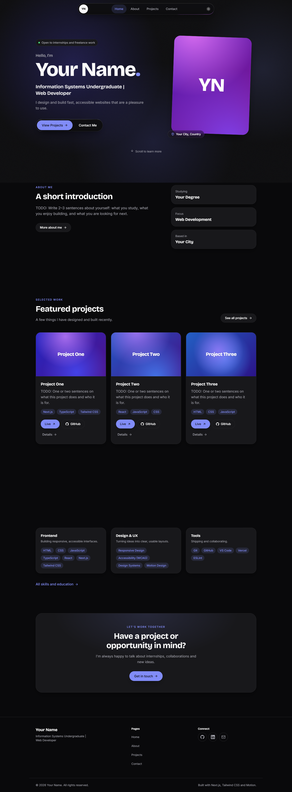
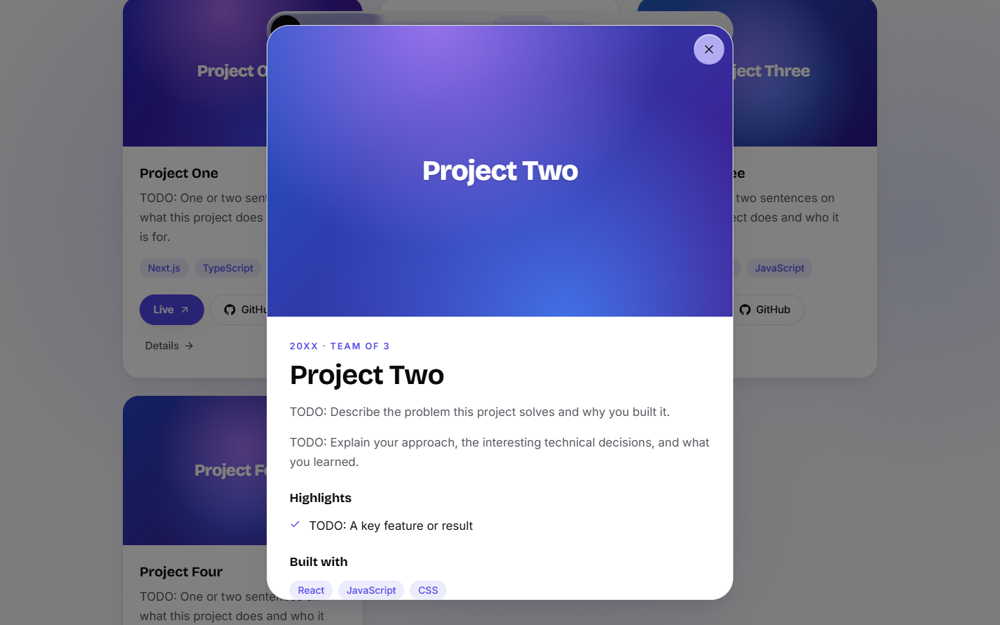
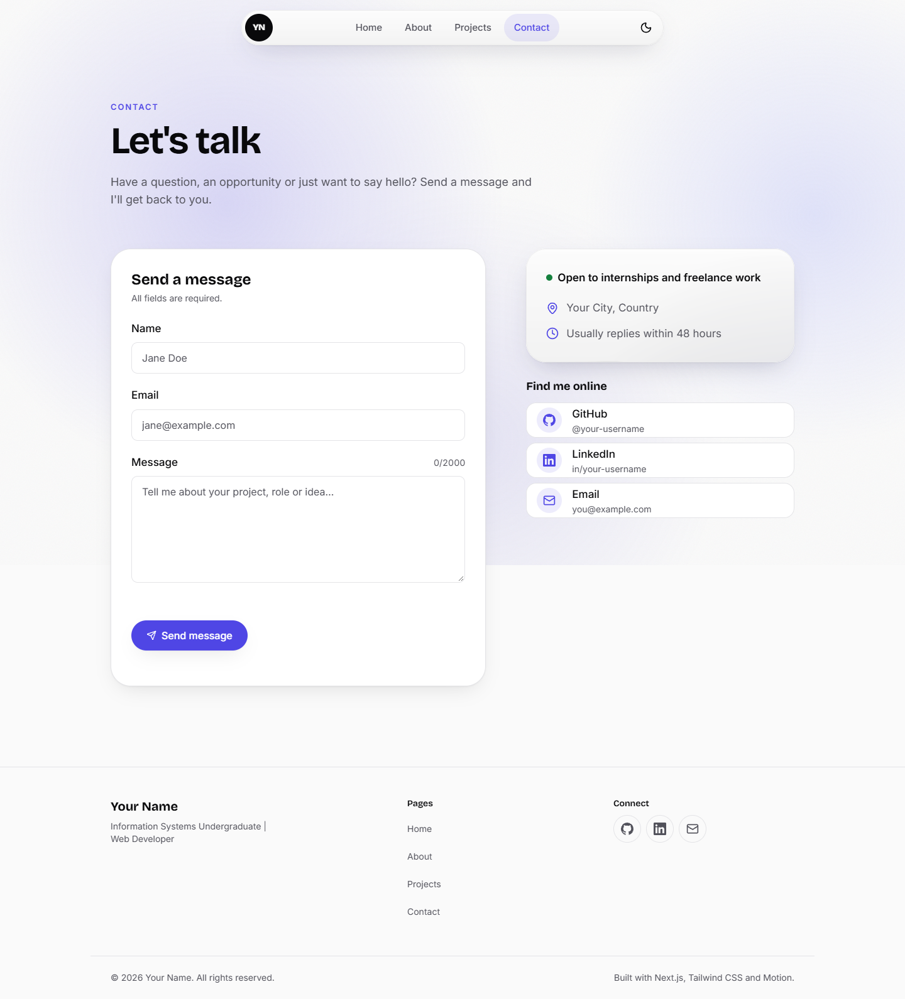
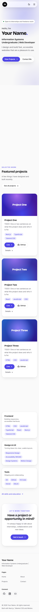

# Personal Portfolio Website

A fast, accessible, responsive personal portfolio built with Next.js, TypeScript and Tailwind CSS. It has a signature **liquid glass** navigation bar, motion-driven interactions, dark/light mode and a working contact form.

**Live site:** https://your-portfolio.vercel.app <!-- TODO: replace after deploying -->

> University assignment: *Task 1: Personal Portfolio Website*. See [Assignment checklist](#assignment-checklist) for where each requirement is met.

## Features
- **Four pages:** Home, About, Projects and Contact, plus a custom 404. A shared floating navbar and a footer appear on every page.
- **Responsive, mobile-first layout:**
  - checked at 360, 768, 1024 and 1440px
  - fluid type and no horizontal scrolling
  - tap targets of at least 44px.
- **Project showcase:**
  - every project comes from [`data/projects.ts`](data/projects.ts)
  - filter by technology, with animated layout transitions
  - accessible detail modal with deep links (`/projects#project-slug`)
  - Live and GitHub buttons on every card.
- **Contact form:**
  - validation with react-hook-form and zod
  - loading, success and error states
  - honeypot spam trap
  - delivers messages by email through [Web3Forms](https://web3forms.com).
- **Liquid glass:** WebGL refraction from [liquid-glass-js](https://github.com/dashersw/liquid-glass-js) on the navbar, the hero call-to-action and the contact card. CSS glass is used as the fallback.
- **Motion:**
  - scroll reveals, staggered lists and an animated active-link indicator, built with [Motion](https://motion.dev)
  - hover and tap feedback
  - View Transitions between pages
  - fully honours `prefers-reduced-motion`.
- **Dark/light mode:** follows the system setting, with a toggle. There is no flash on load.
- **Accessibility:**
  - skip link, visible focus rings, semantic landmarks and one `h1` per page
  - labelled inputs and ARIA on the menu and modal
  - WCAG AA colour contrast.
- **SEO:** per-page titles, descriptions and canonical URLs, Open Graph/Twitter cards (a generated image), favicon, `sitemap.xml`, `robots.txt` and schema.org `Person` data.

## Tech stack
| Area | Choice |
| --- | --- |
| Framework | [Next.js 16](https://nextjs.org) (App Router, static export of every page) |
| Language | TypeScript (strict) |
| Styling | Tailwind CSS v4 + CSS variable design tokens |
| Animation | [Motion](https://motion.dev) (`motion/react`) + React `<ViewTransition>` |
| Glass effect | liquid-glass-js (vendored, see below) + `html2canvas-pro` |
| Theme | `next-themes` |
| Forms | `react-hook-form` + `zod` |
| Icons | `lucide-react` |
| Fonts | `next/font`: Bricolage Grotesque (display) + Inter (body) |

Design decisions (palette, typography, spacing, motion and glass usage) are documented in [DESIGN.md](DESIGN.md).

## Screenshots
| Home (desktop, light) | Home (desktop, dark) |
| --- | --- |
|  |  |

| Projects with detail modal | Contact form | Mobile (360px) |
| --- | --- | --- |
|  |  |  |

## Getting started
Requirements: Node.js 20.9 or newer and npm.

```bash
npm install
cp .env.example .env.local   # then fill in the values
npm run dev                  # http://localhost:3000
```

| Command | What it does |
| --- | --- |
| `npm run dev` | Start the development server |
| `npm run build` | Create a production build |
| `npm run start` | Serve the production build |
| `npm run lint` | ESLint (fails on any warning) |
| `npm run typecheck` | TypeScript check |

## Environment variables
| Variable | Required | Description |
| --- | --- | --- |
| `NEXT_PUBLIC_WEB3FORMS_KEY` | For the contact form | Free access key from [web3forms.com](https://web3forms.com). Messages are emailed to the address you register with. Web3Forms keys are meant to be used in the browser, so the `NEXT_PUBLIC_` prefix is intended. Without a key, the form shows a friendly "not set up yet" message with your email address. |
| `NEXT_PUBLIC_SITE_URL` | Recommended | Your deployed URL (e.g. `https://your-portfolio.vercel.app`). Used for canonical URLs, Open Graph and the sitemap. |
| `NEXT_PUBLIC_LIQUID_GLASS` | No | Set to `off` to always use the CSS glass fallback. |

### Setting up the contact form (Web3Forms)
1. Go to [web3forms.com](https://web3forms.com), enter the email address that should receive messages, and copy the access key they send you.
2. Put the key in `.env.local` as `NEXT_PUBLIC_WEB3FORMS_KEY=...` and restart `npm run dev`.
3. Send a test message from `/contact` and check your inbox (and spam folder the first time).

## Editing your content
All personal content lives in `/data`. No component changes are needed.

- [`data/profile.ts`](data/profile.ts): name, tagline, bio, location, email, social links, education, quick facts, CV path and an optional photo.
- [`data/projects.ts`](data/projects.ts): projects. Add an object to the array to add a project.
  - `featured: true` shows it on the home page.
  - `tags` power the filter.
  - `image` is optional. Without it, a generated gradient artwork is shown, so there are never broken images.
- [`data/skills.ts`](data/skills.ts): skill groups.
- `public/cv-placeholder.pdf`: replace with your CV (or point `cvPath` at a new file).
- Photos and screenshots: put them in `/public` (e.g. `public/projects/my-app.png`). Reference them as `{ src: "/projects/my-app.png", alt: "…", width: 1600, height: 1000 }`.

Search the project for `TODO` to find every placeholder.

## Deploying to Vercel
1. Create an empty repository on GitHub, then push this project:
   ```bash
   git remote add origin https://github.com/<your-username>/<repo-name>.git
   git push -u origin main
   ```
2. Sign in at [vercel.com](https://vercel.com) with GitHub, click **Add New… → Project**, and **Import** the repository. Vercel detects Next.js automatically; keep the default build settings.
3. Before clicking **Deploy**, open **Environment Variables** and add:
   - `NEXT_PUBLIC_WEB3FORMS_KEY`: your Web3Forms key
   - `NEXT_PUBLIC_SITE_URL`: `https://<project-name>.vercel.app` (or your custom domain)
4. Click **Deploy**. When it finishes, open the URL and send a test message from the contact page.
5. Update the **Live site** link at the top of this README. If you change environment variables later, redeploy (**Deployments → ⋯ → Redeploy**), because `NEXT_PUBLIC_` values are baked in at build time.

Every later `git push` to `main` deploys automatically.

## Project structure
```
app/                    routes, layout, global styles, SEO files (sitemap, robots, OG image, icon)
components/
  glass/                GlassSurface + capability detection for liquid glass
  layout/               Navbar, Footer, Background, PageTransition
  sections/             page sections (Hero, ProjectGrid, ContactForm, ...)
  ui/                   reusable primitives (Button, Tag, Reveal, ...)
data/                   all owner content (typed)
lib/                    utilities, zod schema, focus trap, liquid glass core
public/                 static files (CV)
```

## About the liquid glass
liquid-glass-js is not published on npm and is written as browser globals. It also has no clean-up API, which matters in a React app. A typed, modified copy of its `Container` class lives in [`lib/liquid-glass`](lib/liquid-glass) (MIT licence included). It is used as a decorative layer *behind* real links and buttons, so keyboard and screen-reader behaviour stay native.

- **When the WebGL effect runs:** only on desktop-class devices with a fine pointer and WebGL, when the user hasn't asked for reduced motion and Save-Data is off. The library and its page snapshot load only after the visitor first moves the mouse, scrolls or presses a key. They run in idle time, so they never compete with loading or hydration.
- **Fallback:** everyone else gets an equivalent CSS `backdrop-filter` glass, which is also what you see for a moment before the WebGL layer fades in.
- **Previewing the fallback:** add `?glass=off` to any URL, or set `NEXT_PUBLIC_LIQUID_GLASS=off`.

## Assignment checklist
| Requirement | Where it is met |
| --- | --- |
| **Responsive design** | Mobile-first Tailwind layouts; fluid `clamp()` type scale and gutters (`app/globals.css`); grids collapse 3 → 2 → 1 columns; mobile menu (`components/layout/Navbar.tsx`); `next/image` with fixed aspect ratios; tap targets ≥ 44px |
| **Project showcase** | `/projects` (`components/sections/ProjectGrid.tsx`, `ProjectCard.tsx`, `ProjectModal.tsx`) driven by `data/projects.ts`; featured projects on Home |
| **Contact form** | `/contact` (`components/sections/ContactForm.tsx`, `lib/contact-schema.ts`); Web3Forms delivery, validation, loading/success/error states, honeypot |
| **Professional UI** | Design system in `DESIGN.md`; single accent colour, consistent tokens, dark/light mode, liquid glass navbar |
| Task completion | All four pages, shared navbar and footer, CV download, 404, SEO files |
| Code quality | TypeScript strict, ESLint with zero warnings, typed data, reusable components, consistent code standards |
| Responsiveness | Verified at 360/768/1024/1440px with automated overflow and tap-target checks |
| UI design | Editorial layout, Bricolage Grotesque + Inter, gradient mesh + grain background, AA contrast in both themes |
| Creativity | WebGL liquid glass, shared-element modal morph, animated filter and nav indicators, generated project artwork, View Transitions |
| Professional presentation | Real metadata, Open Graph image, favicon, JSON-LD, polished 404 |
| Functionality | Working form delivery, filtering, deep-linkable modal, theme toggle, CV download, keyboard support |

## Credits
- Liquid glass effect: [liquid-glass-js](https://github.com/dashersw/liquid-glass-js) by Armagan Amcalar (MIT)
- Fonts: [Bricolage Grotesque](https://fonts.google.com/specimen/Bricolage+Grotesque) and [Inter](https://fonts.google.com/specimen/Inter) (SIL Open Font License)
- Icons: [Lucide](https://lucide.dev) (ISC)
